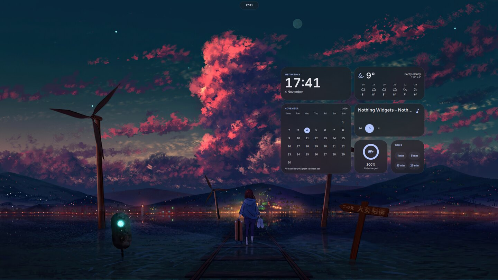
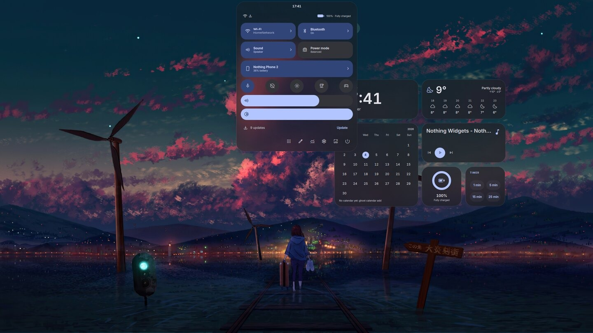
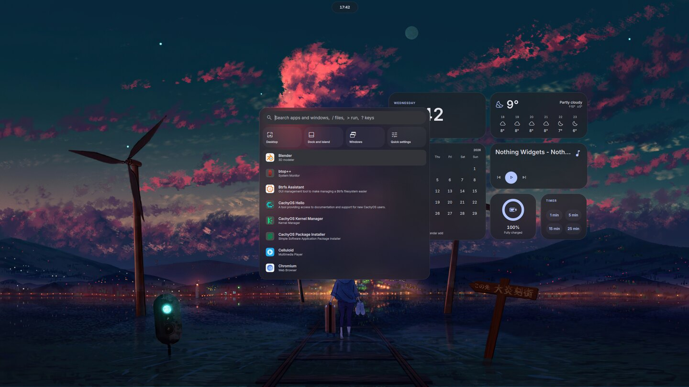
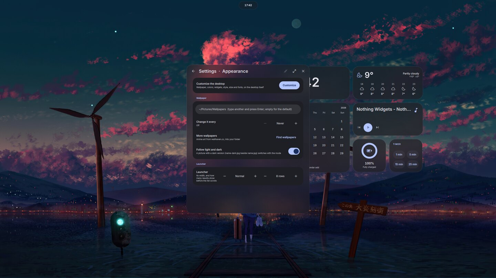
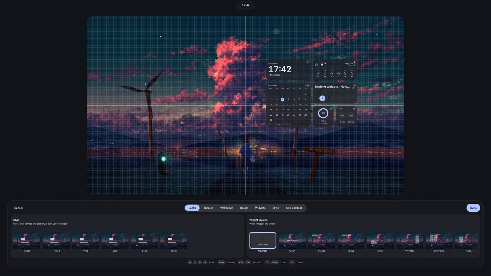
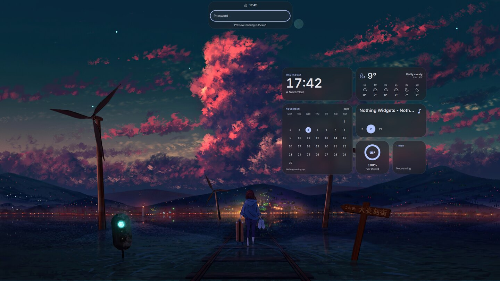

# Ghost Shell

A complete desktop on Arch (CachyOS) built from Hyprland and a Quickshell shell, colored from the
wallpaper. Made for an HP Omen 16 (AMD iGPU + NVIDIA RTX), but split into modules so another
machine can take what it needs.



| | |
|:---:|:---:|
|  **Quick settings** |  **Launcher** |
|  **Settings** |  **Customizing the desktop** |


**The lock screen**: your desktop, locked; the island asks for the password.

## What's in it

- **The island**: the bar, one shape floating below the top edge (or attached to it) with only
  the time (or the playing song's cover) and what needs attention (recording, microphone, camera,
  timer, low battery); switching workspaces shows the dots for a moment. Notifications pop out of
  it one at a time. It opens into menus (click: today, right-click: quick settings): quick
  settings (status icons, Wi-Fi, Bluetooth, sound, power mode, game mode, focus mode, system
  stats, background apps), today (date, weather, the next events, note, timer, notifications),
  media, clipboard, wallpapers (a row of your pictures). An event starting soon shows as "in 12
  min" beside the time. The mouse does more on it: the wheel sets the volume (Shift: brightness,
  Ctrl: workspaces, over the cover: tracks), a middle-click plays or pauses, resting on it shows
  the workspaces, Wi-Fi and battery, its alerts lead where they say (the timer, the recording's
  stop), and files dropped on it go to your phone (KDE Connect) or any device nearby (LocalSend).
- **Windows**: a tiling layout of its own (halves, thirds, quarters from the window menu, or by
  the number of windows), dragging a window by its title bar (or with Super) onto another to swap
  them, Super+Shift+drag to float one, Snap Assist, window tabs, Alt+Tab with live previews, an overview
  (Super+Tab, a three-finger swipe or the top-left corner), minimize, a dock with window previews.
- **The rest of a desktop**: notifications (with sounds), launcher (apps, windows, files with `/`, commands with `>`, emoji with `:`, a calculator), on-screen
  volume and brightness, a lock screen that is your desktop locked (it logs in at boot and locks;
  no login screen), idle and night light, screenshots and screen
  recording, a password prompt for apps (polkit), an equalizer, screen time, web apps
  (`ghost webapp`), an update count, wallpapers (a Wallpapers window browses anime art on
  wallhaven.cc, safe for work only, and downloads what you pick into your folder; `ghost
  wallpapers get` fetches a batch, `--style sky|lofi|painterly|minimal` for one kind), focus
  mode (a 15/25/50-minute timer that holds pop-ups back and hides the widgets, then offers a
  break), and a welcome tour on the first start.
- **Editors on the screen itself** for how it looks, like Android's "Wallpaper & style" with iOS's
  lock screen editing: the desktop (saved themes, wallpaper, colors, desktop widgets, glass, sizes,
  fonts; the lock screen shows the same), the dock and island, and how
  windows look (borders, gaps, animations, on example windows). Each shows the screen as a card
  with live previews and ready-made looks; Super + U picks one, and each works with the keyboard as well as the pointer. Your themes and looks travel to another machine with `ghost looks export` / `import` (a `looks.json` in the repo).
- **Desktop widgets**: a clock, the weather (now or by the hour), the media player, the
  calendar's next events or the whole month, the battery, a to-do list you add to, a note, your
  clipboard, a timer and the notification count on the wallpaper, picked from a gallery and
  dragged into place; the lock screen shows them too (their content hidden). Super+D shows the
  desktop and gives them the keyboard.
- **Accessible**: every menu and widget has names and roles for screen readers (Orca is in the
  core module), the keyboard reaches everything, and the widgets say what they show.
- **Sound**: a five-band equalizer per output, and for the HP Omen 16's speakers their bass
  speakers switched on (the kernel leaves them off), a measured speaker profile and a limiter.
- **A settings app** for what would otherwise be config files: displays, sound, keyboard and
  touchpad, power, default apps, keybinds, Btrfs snapshots and more.
- **Glass**: see-through panels with Hyprland's blur behind exactly their shape (or solid ones).
- **One color scheme** from the wallpaper (matugen) for the shell, Hyprland, Ghostty, GTK apps,
  Zed, Yazi, Zen, Discord, Spotify, Steam and MangoHud.
- **zsh** as the login shell, set up like fish (suggestions as you type, highlighting, history
  search on Up and Down, fzf on Ctrl+R) with a [Starship](https://starship.rs) prompt of rounded pills in the
  wallpaper's colors; fish stays installed.

The full plan and every decision behind it: [ROADMAP.md](ROADMAP.md). Keybinds:
[docs/keybinds.md](docs/keybinds.md). Every feature and rule with its files: [docs/index.md](docs/index.md).

## Install

On Arch or CachyOS, one command (it installs git if needed, clones the repo to
`~/Projects/ghost-shell` and runs the install; zsh, fish or bash):

```sh
curl -fsSL https://raw.githubusercontent.com/RazerGhost/ghost-shell/main/bootstrap.sh -o /tmp/bootstrap.sh
bash /tmp/bootstrap.sh desktop
```

`desktop` or `laptop` picks the machine's modules from `machines/` (they become
`~/.config/ghost/modules`, which you can edit); leave it out for all of them but the opt-in ones.
Add a wallpaper (or `"#22d3ee"` for colors from one color), and `--yes` to answer pacman's and
paru's questions for you (paru then skips showing the PKGBUILDs). From a clone it's the same:
`./install.sh desktop ~/Pictures/some-wallpaper.jpg`.

It installs the packages (AUR ones are built from source, then their build-only dependencies and
build folders are removed), links the configs into your home folder (GNU Stow) and sets up the
system (logging in at boot, services). It asks for your password once. Log out and back in
afterwards. Some app themes need the app started once first; the install says so and
`ghost install <module>` finishes them later.

## The `ghost` command

After the first install, `ghost` (in `~/.local/bin`) does everything:

| Command | |
|---|---|
| `ghost update` | pull the repo, then install again (new packages, new setup steps) |
| `ghost install [module...]` | packages and setup for some or all modules (`--machine laptop\|desktop` picks this machine's from `machines/`, `--yes` answers pacman's and paru's questions) |
| `ghost theme <wallpaper \| "#rrggbb">` | a new wallpaper and the colors from it |
| `ghost calendar add [name]` | subscribe to a calendar (copy the link first: Google Calendar's secret iCal address or any .ics address; `remove <name>`, `list`, `sync`) |
| `ghost looks export` / `import` | your themes and looks into the repo's `looks.json`, or from it on another machine |
| `ghost wallpapers get [words] [--style S]` | anime art from wallhaven.cc into your wallpaper folder (safe for work only) |
| `ghost webapp add <name> <url> [icon]` | a site in its own window, in the launcher and the dock (`remove <name>`, `list`) |
| `ghost doctor` | check that everything is set up; each problem says what fixes it |
| `ghost modules` | list the modules and which ones this machine uses |
| `ghost keybinds` | the keybinds as a Markdown table |

## Modules

Each folder in `modules/` is one part of the setup: its packages (`packages.txt`, `aur.txt`) and
its setup (`setup.sh`).

| Module | |
|---|---|
| `core` | Hyprland, the shell, fonts and themes, the colors, zsh as the login shell |
| `system` | the GPU rule, boot options (Limine), the Omen's bass speakers, logging in at boot (greetd) and services |
| `snapshots` | Btrfs snapshots: the system's before and after every update (bootable), your home folder hourly |
| `apps` | terminal, editor, files, pictures, video, music, browser, web apps |
| `dev` | languages, package managers and Docker |
| `gaming` | Steam, Proton, Lutris, Heroic, MangoHud; Steam's theme |
| `discord`, `spotify`, `zen` | those apps in the wallpaper's colors |
| `haunt` | the Haunt Git client, from its release package, and what building it needs |
| `capture` | screen recording, color picker, text and QR codes from the screen |
| `phone` | KDE Connect and LocalSend |
| `proton` | Proton Mail, Pass and VPN |
| `calendar` | calendar events in the today menu, from a calendar's iCal link (`ghost calendar add`) |
| `llm` | local coding LLM on the NVIDIA GPU: Ollama, OpenCode, Aider (setup and decisions in the ghost-llm repo) |
| `wave3` | the Elgato Wave:3 microphone with openxlr and a voice chain ([its README](modules/wave3/README.md)) |

Every module except `llm` and `wave3` is installed unless `~/.config/ghost/modules` lists the ones this
machine wants, one per line (`llm` and `wave3` only ever come from that list: they're for the machine
with the NVIDIA GPU and the one the microphone is plugged into). That file isn't in the repo, so each
machine keeps its own; `machines/` has the laptop's and the desktop's to start from
(`ghost install --machine desktop`), or write one:

```sh
mkdir -p ~/.config/ghost
printf '%s\n' core apps dev > ~/.config/ghost/modules
```

The `system` module adapts: the AMD + NVIDIA laptop, an NVIDIA-only desktop; the kernel line and
boot menu only with Limine (otherwise it says what to add by hand), the speakers only on the Omen.

## Your own changes

Settings made in the shell's settings window and its editors live outside the repo
(`~/.local/state/quickshell/`). For things the settings window doesn't cover, these files are
loaded last and aren't in git, so `ghost update` never conflicts with them:

| File | For |
|---|---|
| `~/.config/hypr/local.lua` | Hyprland: your own binds, monitors, any option |
| `~/.config/ghostty/local` | Ghostty settings |
| `~/.config/zsh/local.zsh` | zsh: aliases, variables, anything for `.zshrc` |
| `~/.config/fish/conf.d/local.fish` | fish (the fallback shell): aliases, variables |

## If something breaks

- **The lock screen crashed** (a red screen, still locked): Ctrl+Alt+F2, log in, run
  `hyprctl --instance 0 dispatch 'hl.dsp.exec_cmd("hyprlock -c /usr/share/hypr/hyprlock.conf")'`,
  go back with Ctrl+Alt+F1 and unlock with your password.
- **The session won't start** (it starts again and again): Ctrl+Alt+F2, log in,
  `sudo systemctl stop greetd`, fix it (`journalctl --user -b` shows why), then
  `sudo systemctl start greetd`.
- **The shell is gone** (no island): it restarts itself after a crash; if it doesn't,
  `hyprctl dispatch 'hl.dsp.exec_cmd("~/.config/hypr/shell.sh")'` in a terminal (Super+Enter still
  opens one). Super+Shift+L locks with hyprlock meanwhile.
- **Something looks wrong after an update**: `ghost doctor` checks the setup and says what fixes
  each problem.

## Layout

| Folder | |
|---|---|
| `hypr/`, `quickshell/`, `ghostty/`, `zsh/`, `starship/`, `fish/`, `fastfetch/`, `matugen/`, `zed/`, `spotify/`, `pipewire/`, `paru/`, `nautilus/`, `bin/` | configs, linked into `$HOME` by Stow (each mirrors the home folder) |
| `modules/` | packages and setup per module, `lib.sh` shared by them |
| `system/` | files for `/` (udev rule, greetd, mkinitcpio), installed by the `system` module |
| `machines/` | each machine's module list (`ghost install --machine <name>`) |
| `tests/` | tests: `QT_QPA_PLATFORM=offscreen /usr/lib/qt6/bin/qmltestrunner -input tests`, `lua tests/tiling_test.lua` and `bash tests/calendar_test.sh` |
| `docs/` | keybinds and screenshots |

[NOTES.md](NOTES.md) has the Hyprland and Quickshell API facts this was built on.

## Licence

MIT (`LICENSE`). Wallpapers aren't part of the repo: `ghost wallpapers` downloads art from
wallhaven.cc into your own folder, and the art in the screenshots belongs to its artists.
